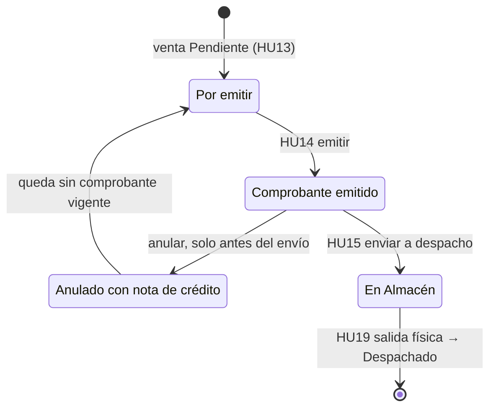
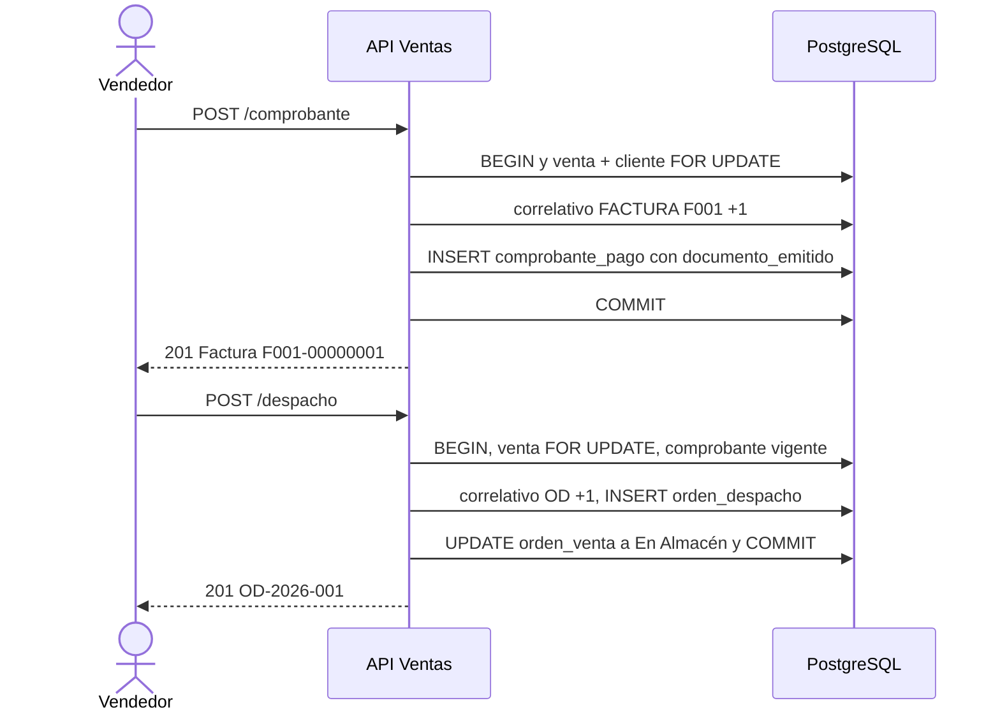

# Comprobante de pago y envío a despacho

HU14 «Emitir comprobante de pago» (PROYEC-25) y HU15 «Enviar orden de despacho a Almacén» (PROYEC-26). El diseño completo, con las maquetas de la interfaz, está en [diseno-hu14-hu15.pdf](diseno-hu14-hu15.pdf). Fuentes: «VSM_Historias de usuario» y «HISTORIAS DE USUARIO RN CA y ENTIDADES - MVP (2)».

## Flujo y responsabilidades

Ventas abre **Ventas confirmadas** (`/ventas/confirmadas`), elige una venta en estado «Pendiente» y presiona «Revisar y emitir comprobante». El sistema decide el tipo con el documento del cliente: RUC → factura F001; DNI → boleta B001. Una entidad pública siempre lleva factura (RN-02). Si el cliente no tiene dirección, se pide antes de emitir (RN-05) y queda guardada en el cliente. El número sale del correlativo dentro de la misma transacción y no se reutiliza (RN-04). Los montos se copian de la venta confirmada y no se editan (RN-06). Emitir no modifica stock ni Kardex (RN-09, CA-04).

Con el comprobante emitido se habilita «Enviar a despacho». Crea la orden `OD-AAAA-NNN` en estado «Pendiente de Despacho», que aparece en la bandeja de Almacén de la HU18, y pasa la venta a «En Almacén» en la misma transacción (RN-02, RN-04, RN-07). Sin comprobante devuelve 409 (CA-02). Una venta genera una sola orden (RN-03). El envío no descuenta stock (RN-08): eso lo hace la salida física de la HU19.

### Corrección de un comprobante

Un comprobante no se edita ni se borra, igual que ante SUNAT. Mientras la venta no se haya enviado a Almacén, Ventas puede **anularlo con una nota de crédito** (serie FC01 para facturas y BC01 para boletas). Para eso indica un motivo del catálogo 09 de SUNAT (01 anulación de la operación, 02 error en el RUC, 03 corrección por error en la descripción) y un sustento. El comprobante queda «Anulado» y la venta puede recibir otro con el número siguiente. Después del envío, una corrección es una devolución o un cambio y corresponde a la Entrega 2.

### SUNAT

El MVP genera el documento dentro del sistema (RN-10). El PDF dice «Representación interna. No válido como comprobante electrónico ante SUNAT». Las series, los números de 8 dígitos, el RUC o DNI, el IGV y las notas de crédito ya tienen la forma que pide SUNAT. Falta preguntarle al cliente si emite en el portal de SUNAT (SEE-SOL) o con un proveedor PSE/OSE, para decidir la integración de la Entrega 2.

## APIs

Todas requieren sesión con rol `Ventas` y responden `Cache-Control: private, no-store`. Cada vendedor solo ve y opera sus propias ventas; las de otro vendedor responden 404.

| Método y ruta | Función |
| --- | --- |
| GET `/api/ventas/confirmadas` | Ventas en Pendiente, En Almacén o Despachado, con comprobante vigente y despacho |
| GET `/api/ventas/confirmadas/:id` | Cliente, documento de respaldo, productos con precios congelados (sin costos), comprobantes, notas, despacho y tipo de comprobante propuesto |
| POST `/api/ventas/confirmadas/:id/comprobante` | HU14. Cuerpo opcional `{"direccion": "..."}` |
| POST `/api/ventas/confirmadas/:id/comprobante/anular` | Cuerpo `{"motivo": "02", "sustento": "..."}` |
| POST `/api/ventas/confirmadas/:id/despacho` | HU15. Sin cuerpo |
| GET `/api/ventas/confirmadas/:id/comprobantes/:idc/pdf` | PDF desde la copia guardada al emitir |
| GET `/api/ventas/confirmadas/:id/notas-credito/:idn/pdf` | PDF de la nota de crédito |

Errores con `{"codigo", "mensaje"}`: 400 `DIRECCION_REQUERIDA`, `DIRECCION_INVALIDA`, `MOTIVO_INVALIDO` o `SUSTENTO_INVALIDO`; 404 `VENTA_NO_ENCONTRADA`; 409 `VENTA_NO_PENDIENTE`, `COMPROBANTE_YA_EMITIDO`, `SIN_COMPROBANTE`, `DESPACHO_YA_ENVIADO`, `MONTOS_PENDIENTES` o `DOCUMENTO_CLIENTE_INVALIDO`.

## Persistencia y concurrencia

Aplicar `018_comprobante_anulacion.sql` una sola vez, después de la 017. Agrega a `comprobante_pago` las columnas `estado` (Emitido / Anulado) y `documento_emitido`. Cambia la restricción única por un índice parcial: **un comprobante vigente por venta**, lo que ajusta la RN-07. También crea `nota_credito` y admite el tipo `NOTA_CREDITO` en `correlativo_documento`. Las restricciones anteriores se buscan por su definición, porque se crearon sin nombre. Ya fue aplicada en la BD local durante este trabajo; otros entornos deben aplicarla por separado.

Cada operación bloquea la venta con `FOR UPDATE` y el correlativo con su upsert, igual que la emisión de órdenes de compra. Dos emisiones simultáneas producen un solo número: la segunda recibe 409. Los índices únicos también cubren el doble clic.

## Contrato con la HU13 y cambios en otras historias

Todo lo que se lee de una venta confirmada está en `leerVentaConfirmada` y `leerLineasVenta` (`ventaConfirmada.repository.js`): `orden_venta.estado = 'Pendiente'`, `tasa_igv`, `subtotal`, `igv`, `total`, `tipo_documento_cliente`, `numero_documento_cliente` y, de `detalle_orden_venta`, `cantidad`, `precio_unitario` e `importe`. Si la HU13 guarda estos datos de otra forma, solo cambian esas dos funciones.

- HU18 (`despacho.repository.js`): el `LEFT JOIN` filtra `cp.estado = 'Emitido'` para que una factura anulada no duplique la fila en la bandeja de Almacén.
- HU10/HU12 (`precioVenta.repository.js`): la reserva cuenta `v.estado IN ('Pendiente', 'En Almacén')`. Sin este cambio, al enviar a despacho los pares volverían a figurar como disponibles antes de salir del almacén (RN-08).
- HU19 (PR #19) no cambia: usa «Pendiente de Despacho» y deja la venta en «Despachado».

## Pruebas

- `node --test` en el backend: `comprobante.domain.test.js`, `ventaConfirmada.routes.test.js` (roles, 404/409, BEGIN/COMMIT/ROLLBACK, sin tocar stock ni Kardex, PDF) y `encajeDespacho.test.js`.
- `npm test` en el frontend: `VentasConfirmadas.test.tsx` (menú solo para Ventas, dirección obligatoria, envío deshabilitado sin comprobante, anulación y nueva emisión).
- `node scripts/probarComprobanteDespacho.mjs`: aplica las migraciones 001 a 018 en un esquema temporal, recorre venta Pendiente → comprobante → anulación → nuevo comprobante → despacho → bandeja de Almacén, y comprueba la emisión simultánea, la reserva y que el stock coincide con el Kardex. Al final borra el esquema.
